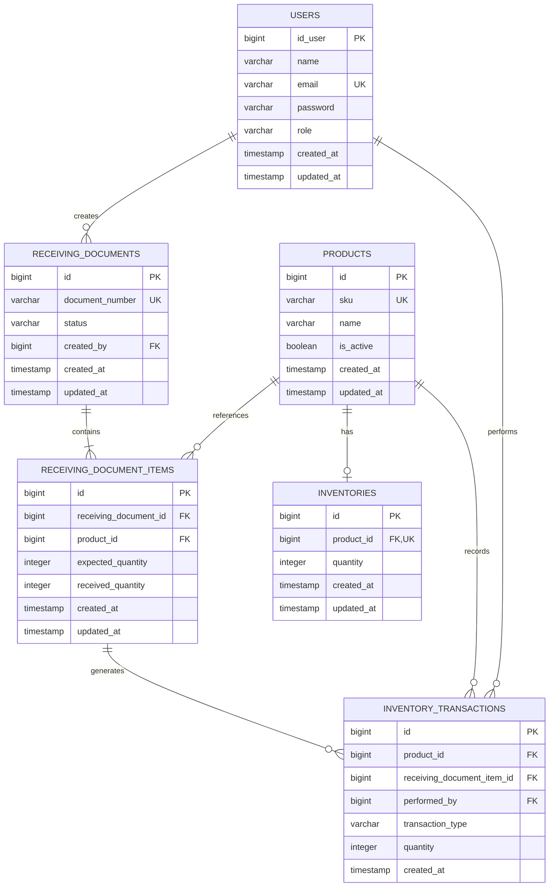

# Entity Relationship Diagram (ERD)

## Warehouse Receiving System

Diagram ini menggambarkan hubungan antara pengguna, produk,
dokumen penerimaan, rincian penerimaan, inventaris, dan transaksi stok.

## Business Rules

1. Setiap produk memiliki SKU yang unik.
2. Setiap dokumen penerimaan memiliki nomor dokumen yang unik.
3. Satu dokumen penerimaan memiliki satu atau lebih rincian produk.
4. Jumlah yang diterima tidak boleh melebihi jumlah yang diharapkan.
5. Satu produk hanya memiliki maksimal satu baris inventaris.
6. Setiap penerimaan yang berhasil harus memperbarui jumlah diterima, stok inventaris, dan riwayat transaksi secara atomik.
7. Dokumen hanya berstatus `completed` jika seluruh barang telah diterima sesuai jumlah yang diharapkan.
8. Satu rincian penerimaan dapat menghasilkan beberapa transaksi stok karena penerimaan parsial.
