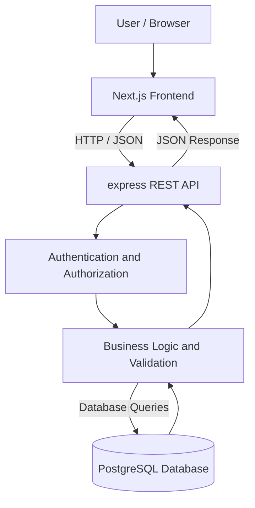
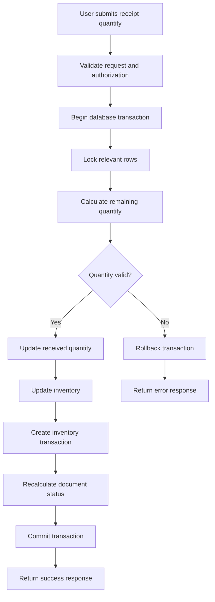
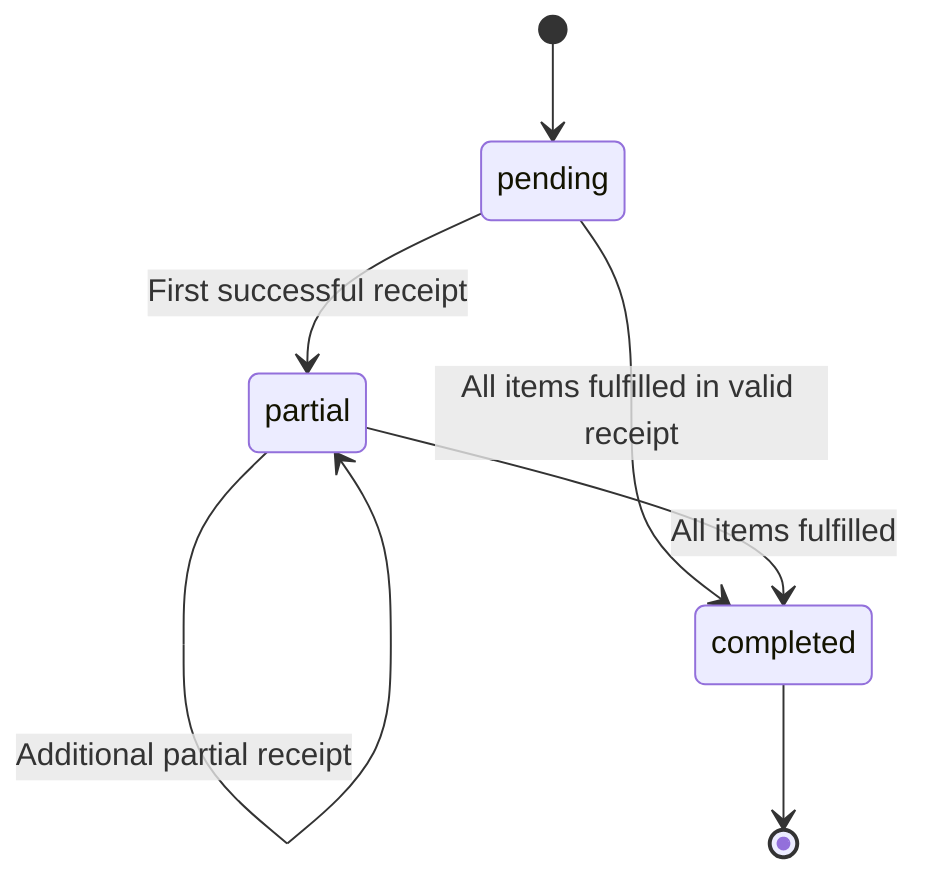

# Technical Specification

## Warehouse Receiving System

**Version:** 1.0  
**Status:** Draft  
**Related Documents:** `prd.md`, `erd.md`

---

## 1. System Architecture

### 1.1 Architecture Overview

Warehouse Receiving System menggunakan arsitektur client-server yang terdiri dari frontend, backend API, dan relational database.

Komponen sistem:

1. **Frontend:** Next.js menggunakan TypeScript untuk menampilkan antarmuka pengguna dan mengirim permintaan ke backend.
2. **Backend:** express menyediakan REST API, autentikasi, validasi bisnis, dan pemrosesan transaksi.
3. **Database:** PostgreSQL menyimpan data pengguna, produk, dokumen penerimaan, inventaris, dan riwayat transaksi.
4. **Authentication:** Laravel Sanctum digunakan untuk autentikasi API.
5. **Containerization:** Docker dan Docker Compose digunakan untuk menjalankan aplikasi dan database dengan konfigurasi yang terdokumentasi.

Stack tersebut merupakan pilihan implementasi yang diusulkan. Framework dan layanan dapat disesuaikan selama memenuhi persyaratan assessment.

### 1.2 Architecture Diagram



### 1.3 Architecture Responsibilities

| Component      | Responsibilities                                                          |
| -------------- | ------------------------------------------------------------------------- |
| Frontend       | Menampilkan halaman produk, dokumen penerimaan, inventaris, dan transaksi |
| Backend API    | Memproses request, validasi, autentikasi, dan aturan bisnis               |
| Database       | Menyimpan data secara konsisten dan menjaga integritas relasi             |
| Authentication | Memverifikasi identitas pengguna                                          |
| Authorization  | Membatasi akses berdasarkan role                                          |
| Docker         | Menyediakan lingkungan aplikasi yang dapat dijalankan secara konsisten    |

---

## 2. Database Design

Database menggunakan PostgreSQL dengan enam tabel utama sesuai rancangan ERD.

### 2.1 Users

Menyimpan informasi pengguna yang dapat mengakses sistem.

| Column     | Type         | Constraint                   |
| ---------- | ------------ | ---------------------------- |
| id         | BIGINT       | Primary Key                  |
| name       | VARCHAR(255) | NOT NULL                     |
| email      | VARCHAR(255) | UNIQUE, NOT NULL             |
| password   | VARCHAR(255) | NOT NULL                     |
| role       | VARCHAR(30)  | NOT NULL                     |
| created_at | TIMESTAMP    | Nullable sesuai implementasi |
| updated_at | TIMESTAMP    | Nullable sesuai implementasi |

Nilai role yang didukung pada MVP:

- `operator`
- `supervisor`

Password harus disimpan dalam bentuk hash, bukan teks biasa.

### 2.2 Products

Menyimpan master data produk.

| Column     | Type         | Constraint                   |
| ---------- | ------------ | ---------------------------- |
| id         | BIGINT       | Primary Key                  |
| sku        | VARCHAR(100) | UNIQUE, NOT NULL             |
| name       | VARCHAR(255) | NOT NULL                     |
| is_active  | BOOLEAN      | NOT NULL, default TRUE       |
| created_at | TIMESTAMP    | Nullable sesuai implementasi |
| updated_at | TIMESTAMP    | Nullable sesuai implementasi |

SKU digunakan sebagai identitas produk yang unik. Produk yang sudah memiliki riwayat transaksi tidak boleh dihapus secara fisik jika penghapusan tersebut merusak referensi historis. Produk dapat dinonaktifkan melalui `is_active`.

### 2.3 Receiving Documents

Menyimpan informasi utama dokumen penerimaan barang.

| Column          | Type         | Constraint                   |
| --------------- | ------------ | ---------------------------- |
| id              | BIGINT       | Primary Key                  |
| document_number | VARCHAR(100) | UNIQUE, NOT NULL             |
| status          | VARCHAR(30)  | NOT NULL                     |
| created_by      | BIGINT       | Foreign Key → users.id       |
| created_at      | TIMESTAMP    | Nullable sesuai implementasi |
| updated_at      | TIMESTAMP    | Nullable sesuai implementasi |

Status yang didukung:

- `pending`
- `partial`
- `completed`

Nomor dokumen harus unik. Pembuatan dokumen dan rincian barang harus divalidasi agar dokumen tidak dibuat dalam keadaan tanpa item.

### 2.4 Receiving Document Items

Menyimpan rincian produk di setiap dokumen penerimaan.

| Column                | Type      | Constraint                           |
| --------------------- | --------- | ------------------------------------ |
| id                    | BIGINT    | Primary Key                          |
| receiving_document_id | BIGINT    | Foreign Key → receiving_documents.id |
| product_id            | BIGINT    | Foreign Key → products.id            |
| expected_quantity     | INTEGER   | NOT NULL, > 0                        |
| received_quantity     | INTEGER   | NOT NULL, default 0, >= 0            |
| created_at            | TIMESTAMP | Nullable sesuai implementasi         |
| updated_at            | TIMESTAMP | Nullable sesuai implementasi         |

Aturan:

- `received_quantity` tidak boleh melebihi `expected_quantity`.
- Produk yang digunakan harus valid dan aktif ketika item dibuat.
- Setiap item harus terhubung dengan dokumen dan produk yang valid.
- Satu produk tidak perlu muncul lebih dari sekali dalam dokumen yang sama. Backend harus menolak item produk duplikat dalam satu dokumen atau menggabungkannya melalui aturan yang konsisten.

### 2.5 Inventories

Menyimpan stok terkini setiap produk.

| Column     | Type      | Constraint                        |
| ---------- | --------- | --------------------------------- |
| id         | BIGINT    | Primary Key                       |
| product_id | BIGINT    | Foreign Key → products.id, UNIQUE |
| quantity   | INTEGER   | NOT NULL, default 0, >= 0         |
| created_at | TIMESTAMP | Nullable sesuai implementasi      |
| updated_at | TIMESTAMP | Nullable sesuai implementasi      |

Setiap produk hanya boleh memiliki satu baris inventaris. Baris inventaris dibuat saat produk dibuat atau melalui mekanisme inisialisasi stok yang konsisten.

Stok hanya bertambah ketika penerimaan barang berhasil diproses.

### 2.6 Inventory Transactions

Menyimpan riwayat perubahan stok.

| Column                     | Type        | Constraint                                |
| -------------------------- | ----------- | ----------------------------------------- |
| id                         | BIGINT      | Primary Key                               |
| product_id                 | BIGINT      | Foreign Key → products.id                 |
| receiving_document_item_id | BIGINT      | Foreign Key → receiving_document_items.id |
| performed_by               | BIGINT      | Foreign Key → users.id                    |
| transaction_type           | VARCHAR(30) | NOT NULL                                  |
| quantity                   | INTEGER     | NOT NULL, > 0                             |
| created_at                 | TIMESTAMP   | NOT NULL                                  |

Untuk MVP, `transaction_type` menggunakan nilai `receipt`.

Kolom `quantity` menyimpan jumlah unit yang diterima dalam transaksi tersebut, bukan total stok setelah transaksi.

Satu item penerimaan dapat menghasilkan beberapa catatan transaksi karena penerimaan dapat dilakukan secara bertahap.

### 2.7 Database Integrity

Backend dan database harus menjaga aturan berikut:

1. Semua foreign key harus merujuk pada data yang valid.
2. SKU, email, dan nomor dokumen harus unik.
3. Jumlah stok dan jumlah diterima tidak boleh negatif.
4. Jumlah diterima tidak boleh melampaui jumlah yang diharapkan.
5. Stok tidak boleh berubah jika proses penerimaan gagal.
6. Pembaruan stok, jumlah diterima, dan pencatatan transaksi harus dilakukan dalam satu database transaction.
7. Constraint database digunakan bersama validasi backend untuk melindungi integritas data.

Aturan lintas kolom seperti `received_quantity <= expected_quantity` perlu dijamin melalui validasi dan transaksi backend. Constraint tambahan dapat digunakan jika sesuai dengan implementasi database.

---

## 3. API Contract

### 3.1 General API Convention

Base path:

`/api`

Format request dan response menggunakan JSON.

Endpoint yang membutuhkan autentikasi harus menggunakan kredensial autentikasi yang valid.

Format error standar:

```json
{
  "message": "Validation failed",
  "errors": {
    "quantity": ["Quantity exceeds remaining expected quantity."]
  }
}
```

Field `errors` dapat dihilangkan untuk error yang tidak berkaitan dengan validasi field.

### 3.2 Authentication Endpoints

| Method | Endpoint        | Description                                     |
| ------ | --------------- | ----------------------------------------------- |
| POST   | `/api/register` | Membuat akun pengguna jika registrasi diizinkan |
| POST   | `/api/login`    | Melakukan autentikasi                           |
| POST   | `/api/logout`   | Mengakhiri sesi atau mencabut token             |
| GET    | `/api/me`       | Mengambil informasi pengguna yang sedang login  |

Registrasi publik tidak boleh memberi pengguna hak supervisor secara otomatis. Akun supervisor harus dibuat atau diberikan oleh mekanisme administratif yang aman.

### 3.3 Product Endpoints

| Method | Endpoint             | Description                                                                    |
| ------ | -------------------- | ------------------------------------------------------------------------------ |
| GET    | `/api/products`      | Menampilkan daftar produk                                                      |
| POST   | `/api/products`      | Membuat produk                                                                 |
| GET    | `/api/products/{id}` | Melihat detail produk                                                          |
| PUT    | `/api/products/{id}` | Memperbarui informasi produk                                                   |
| PATCH  | `/api/products/{id}` | Memperbarui field produk tertentu, jika didukung                               |
| DELETE | `/api/products/{id}` | Menonaktifkan produk atau menolak penghapusan jika memiliki referensi historis |

Contoh request membuat produk:

```json
{
  "sku": "KB-001",
  "name": "Keyboard Mechanical"
}
```

Validasi:

- `sku` wajib diisi dan unik.
- `name` wajib diisi.
- Produk baru aktif secara default.
- Penghapusan produk harus menjaga riwayat dokumen dan transaksi.

### 3.4 Receiving Document Endpoints

| Method | Endpoint                        | Description                                              |
| ------ | ------------------------------- | -------------------------------------------------------- |
| GET    | `/api/receiving-documents`      | Menampilkan daftar dokumen                               |
| POST   | `/api/receiving-documents`      | Membuat dokumen beserta item                             |
| GET    | `/api/receiving-documents/{id}` | Menampilkan detail dokumen dan item                      |
| PUT    | `/api/receiving-documents/{id}` | Memperbarui dokumen jika masih memenuhi aturan perubahan |

Contoh request:

```json
{
  "document_number": "RCV-2026-001",
  "items": [
    {
      "product_id": 1,
      "expected_quantity": 20
    },
    {
      "product_id": 2,
      "expected_quantity": 15
    }
  ]
}
```

Ketentuan:

- Nomor dokumen harus unik.
- Dokumen harus mempunyai minimal satu item.
- Semua produk harus valid dan aktif.
- `received_quantity` dimulai dari 0.
- Status awal adalah `pending`.
- Pembuatan dokumen dan seluruh item dilakukan secara atomik.
- Perubahan dokumen yang sudah memiliki penerimaan harus dibatasi agar tidak mengubah riwayat atau membuat jumlah diterima tidak valid.

### 3.5 Receiving Operations

| Method | Endpoint                                               | Description                |
| ------ | ------------------------------------------------------ | -------------------------- |
| POST   | `/api/receiving-documents/{id}/items/{itemId}/receive` | Mencatat penerimaan barang |

Contoh request:

```json
{
  "quantity": 5
}
```

Contoh response berhasil:

```json
{
  "message": "Receipt recorded successfully",
  "data": {
    "document_number": "RCV-2026-001",
    "status": "partial",
    "item": {
      "product_id": 1,
      "expected_quantity": 20,
      "received_quantity": 5,
      "remaining_quantity": 15
    },
    "inventory": {
      "product_id": 1,
      "quantity": 5
    }
  }
}
```

Response tersebut merupakan contoh untuk kondisi awal ketika stok produk adalah 0 dan belum ada penerimaan sebelumnya.

Validasi penerimaan:

1. Dokumen harus ditemukan.
2. Item harus termasuk dalam dokumen yang ditentukan.
3. Quantity harus berupa integer positif.
4. Dokumen tidak boleh berstatus `completed`.
5. Quantity tidak boleh melebihi sisa jumlah yang diharapkan.
6. Stok dan jumlah diterima hanya diperbarui setelah seluruh validasi berhasil.
7. Setiap penerimaan berhasil harus menghasilkan satu catatan transaksi stok.

### 3.6 Inventory Endpoints

| Method | Endpoint                           | Description                              |
| ------ | ---------------------------------- | ---------------------------------------- |
| GET    | `/api/inventory`                   | Menampilkan stok seluruh produk          |
| GET    | `/api/inventory/{productId}`       | Menampilkan stok produk tertentu         |
| GET    | `/api/inventory/transactions`      | Menampilkan riwayat transaksi stok       |
| GET    | `/api/inventory/transactions/{id}` | Melihat detail transaksi jika diperlukan |

Riwayat transaksi sebaiknya mendukung filter produk dan rentang waktu jika implementasi memungkinkan.

Stok pada endpoint inventaris berasal dari tabel `inventories`, sedangkan riwayat perubahan berasal dari `inventory_transactions`.

### 3.7 HTTP Status Codes

| Status                    | Meaning                                                           |
| ------------------------- | ----------------------------------------------------------------- |
| 200 OK                    | Request berhasil                                                  |
| 201 Created               | Resource berhasil dibuat                                          |
| 401 Unauthorized          | Autentikasi tidak valid atau tidak tersedia                       |
| 403 Forbidden             | Pengguna tidak memiliki izin                                      |
| 404 Not Found             | Resource tidak ditemukan                                          |
| 409 Conflict              | Konflik state, duplikasi, atau operasi yang tidak dapat dilakukan |
| 422 Unprocessable Entity  | Validasi input gagal                                              |
| 500 Internal Server Error | Terjadi kesalahan internal                                        |

Response error harus jelas dan tidak membocorkan stack trace atau informasi sensitif.

---

## 4. Data Flow

### 4.1 Product Creation Flow

1. Pengguna membuka halaman produk.
2. Pengguna mengisi SKU dan nama produk.
3. Frontend mengirim `POST /api/products`.
4. Backend memvalidasi request dan hak akses pengguna.
5. Backend menyimpan produk dan menyiapkan baris inventaris dengan stok awal 0.
6. Backend mengembalikan response berhasil.
7. Frontend memperbarui daftar produk.

Jika pembuatan produk dan baris inventaris dilakukan bersamaan, keduanya harus berhasil atau dibatalkan bersama-sama.

### 4.2 Receiving Document Creation Flow

1. Pengguna membuka halaman dokumen penerimaan.
2. Pengguna memasukkan nomor dokumen dan satu atau lebih item produk.
3. Frontend mengirim request ke endpoint pembuatan dokumen.
4. Backend memvalidasi nomor dokumen, produk, dan quantity.
5. Backend membuat dokumen dan seluruh item dalam satu database transaction.
6. Backend mengembalikan detail dokumen.
7. Frontend menampilkan dokumen yang baru dibuat.

### 4.3 Receipt Processing Flow

1. Pengguna membuka detail dokumen penerimaan.
2. Pengguna memasukkan jumlah barang yang benar-benar diterima.
3. Frontend mengirim request penerimaan barang.
4. Backend memeriksa autentikasi, izin, status dokumen, dan item.
5. Backend memulai database transaction.
6. Backend mengunci baris yang relevan atau menggunakan strategi concurrency control yang sesuai.
7. Backend menghitung sisa quantity berdasarkan data terbaru.
8. Jika quantity valid, backend memperbarui `received_quantity` dan `inventories.quantity`.
9. Backend membuat catatan `inventory_transactions`.
10. Backend menghitung ulang status dokumen.
11. Backend melakukan commit.
12. Frontend menampilkan jumlah diterima, sisa quantity, status, dan stok terbaru.

Jika langkah pemrosesan gagal, perubahan database harus di-rollback.

### 4.4 Receipt Data Flow Diagram



---

## 5. State Transitions

### 5.1 Document Status Definitions

| Status      | Description                                                         |
| ----------- | ------------------------------------------------------------------- |
| `pending`   | Belum ada item yang menerima barang                                 |
| `partial`   | Sudah ada penerimaan, tetapi masih ada quantity yang belum diterima |
| `completed` | Semua item telah diterima sesuai jumlah yang diharapkan             |

### 5.2 State Transition Rules



Status dihitung berdasarkan seluruh item dalam dokumen.

Aturan perhitungan:

- `pending`: seluruh item memiliki `received_quantity = 0`.
- `partial`: setidaknya satu item telah menerima barang, tetapi belum seluruh item terpenuhi.
- `completed`: semua item memiliki `received_quantity = expected_quantity`.

Dokumen tidak boleh menjadi `completed` jika masih ada item yang belum terpenuhi.

Status tidak boleh dimundurkan dari `completed` melalui operasi penerimaan normal. Pembatalan dokumen dan pengembalian barang berada di luar scope MVP dan memerlukan aturan terpisah.

---

## 6. Authorization and Security

### 6.1 Roles

Sistem menggunakan dua role pada MVP.

| Feature                        | Operator | Supervisor         |
| ------------------------------ | -------- | ------------------ |
| Melihat daftar produk          | Yes      | Yes                |
| Membuat dan memperbarui produk | Yes      | Yes                |
| Melihat dokumen penerimaan     | Yes      | Yes                |
| Membuat dokumen penerimaan     | Yes      | Yes                |
| Mencatat penerimaan            | Yes      | Yes                |
| Melihat inventaris             | Yes      | Yes                |
| Melihat riwayat transaksi      | Yes      | Yes                |
| Mengelola role pengguna        | No       | Belum termasuk MVP |

Matriks di atas merupakan asumsi awal untuk MVP. Jika PRD atau keputusan bisnis menetapkan pembatasan tambahan, matriks ini harus diperbarui sebelum implementasi.

### 6.2 Security Requirements

1. Endpoint yang membutuhkan autentikasi harus memverifikasi identitas pengguna.
2. Backend harus memeriksa authorization pada setiap operasi yang dilindungi.
3. Role tidak boleh dipercaya hanya berdasarkan nilai yang dikirim frontend.
4. Password harus di-hash menggunakan mekanisme yang aman.
5. Token atau session credential tidak boleh disimpan dalam source code.
6. Secret dan konfigurasi environment harus menggunakan environment variables.
7. Input harus divalidasi pada backend meskipun frontend sudah melakukan validasi.
8. Error tidak boleh menampilkan password, token, atau detail internal database.
9. Operasi yang mengubah stok harus dicatat dengan `performed_by`.
10. Akun supervisor tidak boleh diperoleh melalui registrasi publik biasa.

Jika menggunakan Laravel Sanctum dengan cookie-based authentication, CSRF dan konfigurasi stateful domain harus ditangani. Jika menggunakan token Bearer, penyimpanan token di frontend harus dirancang dengan aman.

---

## 7. Concurrency and Data Consistency

Sistem harus mencegah stok dan jumlah penerimaan menjadi tidak konsisten ketika beberapa request berjalan bersamaan.

### 7.1 Atomic Receipt Processing

Perubahan berikut wajib berada dalam satu database transaction:

- Memperbarui `receiving_document_items.received_quantity`.
- Memperbarui `inventories.quantity`.
- Menambahkan baris `inventory_transactions`.
- Memperbarui status dokumen.

Jika satu operasi gagal, semua perubahan dalam transaksi tersebut harus dibatalkan.

### 7.2 Concurrent Requests

Contoh masalah:

Sisa quantity adalah 5 unit. Dua request masing-masing mencoba menerima 4 unit secara bersamaan. Tanpa concurrency control, kedua request dapat membaca sisa yang sama dan menyebabkan over-receiving.

Pencegahan:

1. Mulai database transaction.
2. Ambil lock pada baris item yang relevan, misalnya menggunakan `SELECT ... FOR UPDATE`.
3. Baca ulang quantity terbaru.
4. Hitung ulang sisa quantity.
5. Tolak request jika jumlah yang diminta melebihi sisa.
6. Perbarui item, inventaris, dan transaksi.
7. Commit jika seluruh operasi berhasil.

Strategi harus diuji dengan database PostgreSQL yang digunakan pada lingkungan implementasi.

### 7.3 Duplicate Requests

Request yang dikirim ulang tidak boleh menyebabkan stok bertambah tanpa kendali.

Untuk MVP, backend wajib melakukan validasi state dan locking. Jika waktu dan cakupan memungkinkan, tambahkan idempotency key atau mekanisme identifikasi request unik untuk mencegah pengulangan operasi yang sama akibat retry jaringan.

---

## 8. Testing Strategy

### 8.1 Unit Tests

Unit test harus mencakup:

- Perhitungan sisa quantity.
- Perhitungan status dokumen.
- Validasi quantity positif.
- Penolakan over-receiving.
- Validasi bahwa dokumen completed tidak menerima tambahan barang.
- Validasi role dan permission.

### 8.2 API Feature Tests

| Test Case                                    | Expected Result                                    |
| -------------------------------------------- | -------------------------------------------------- |
| Login menggunakan kredensial valid           | Berhasil                                           |
| Login menggunakan password salah             | Ditolak                                            |
| Membuat produk dengan SKU baru               | Berhasil                                           |
| Membuat produk dengan SKU duplikat           | Ditolak                                            |
| Membuat dokumen dengan item valid            | Berhasil                                           |
| Membuat dokumen tanpa item                   | Ditolak                                            |
| Menerima sebagian quantity                   | Jumlah diterima dan stok bertambah sesuai quantity |
| Menerima seluruh sisa quantity               | Dokumen menjadi completed                          |
| Menerima quantity melebihi sisa              | Request ditolak dan database tidak berubah         |
| Mengirim quantity nol atau negatif           | Request ditolak                                    |
| Mengakses endpoint terlindungi tanpa login   | Ditolak                                            |
| Mengirim request dengan role tidak berizin   | Ditolak                                            |
| Menerima barang pada dokumen completed       | Ditolak                                            |
| Mengirim request yang gagal di tengah proses | Semua perubahan di-rollback                        |
| Mengirim request penerimaan bersamaan        | Tidak boleh terjadi over-receiving                 |

### 8.3 Inventory Consistency Tests

Gunakan contoh berikut:

1. Buat produk dengan stok awal 0.
2. Buat dokumen dengan expected quantity 20.
3. Terima 8 unit.
4. Verifikasi `received_quantity = 8`.
5. Verifikasi `inventories.quantity = 8`.
6. Verifikasi satu transaksi penerimaan berjumlah 8.
7. Terima lagi 7 unit.
8. Verifikasi `received_quantity = 15`.
9. Verifikasi `inventories.quantity = 15`.
10. Verifikasi total transaksi penerimaan untuk item tersebut adalah 15.
11. Coba menerima 6 unit lagi.
12. Verifikasi request ditolak karena sisa hanya 5 unit.
13. Verifikasi quantity diterima, stok, dan riwayat transaksi tidak berubah akibat request yang ditolak.

### 8.4 Test Environment

- Gunakan database testing terpisah dari database development.
- Siapkan data test melalui factories atau seeding yang terkendali.
- Test harus dapat dijalankan ulang tanpa bergantung pada data manual.
- Jangan menjalankan test yang mereset database pada database yang menyimpan data penting.
- Dokumentasikan perintah untuk menjalankan seluruh test pada `README.md` atau `docs/testing.md`.

---

## 9. Deployment and Operations

### 9.1 Docker Requirements

Proyek harus menyediakan konfigurasi yang dibutuhkan untuk menjalankan:

- Frontend Next.js.
- Backend Laravel.
- PostgreSQL.
- Layanan pendukung yang diperlukan, jika ada.

Docker Compose harus menggunakan konfigurasi environment yang terdokumentasi.

### 9.2 Environment Configuration

Contoh variabel yang dibutuhkan:

Backend:

- `APP_ENV`
- `APP_KEY`
- `APP_URL`
- `DB_CONNECTION`
- `DB_HOST`
- `DB_PORT`
- `DB_DATABASE`
- `DB_USERNAME`
- `DB_PASSWORD`

Frontend:

- `NEXT_PUBLIC_API_URL`

Gunakan file `.env.example` sebagai template tanpa secret asli. File `.env` yang berisi kredensial tidak boleh dimasukkan ke Git.

### 9.3 Database Migrations

- Semua tabel dibuat menggunakan migration yang disimpan dalam repository.
- Migration harus dapat dijalankan pada database kosong.
- Foreign key, unique constraint, dan constraint quantity harus didokumentasikan.
- Data awal hanya ditambahkan melalui seeder yang memang dibutuhkan.

### 9.4 Health Check

Backend harus menyediakan endpoint health check, misalnya:

`GET /api/health`

Endpoint mengembalikan status layanan yang sesuai. Jika health check juga memverifikasi database, kegagalan koneksi database harus tercermin dalam status respons.

### 9.5 Startup Documentation

README harus menjelaskan:

1. Prasyarat instalasi.
2. Cara menyiapkan environment variables.
3. Cara membangun dan menjalankan Docker Compose.
4. Cara menjalankan database migrations.
5. Cara menyiapkan akun awal yang aman.
6. Cara menjalankan automated tests.
7. URL frontend dan backend.
8. Cara memverifikasi health check.

---

## 10. Scope and Limitations

### 10.1 Included in MVP

- Autentikasi dasar.
- Pengelolaan produk.
- Pembuatan dan daftar dokumen penerimaan.
- Penerimaan barang parsial maupun penuh.
- Pembaruan stok otomatis.
- Daftar inventaris.
- Riwayat transaksi stok.
- Validasi dan database transaction.
- Automated tests.
- Docker dan dokumentasi startup.

### 10.2 Excluded from MVP

- Manajemen supplier.
- Purchase order.
- Pengiriman barang keluar dan penjualan.
- Pengelolaan multi-warehouse.
- Barcode scanning.
- Pengembalian barang dan barang rusak.
- Notifikasi eksternal.
- Laporan analitik lanjutan.
- Integrasi sistem pihak ketiga.

### 10.3 Open Questions and Assumptions

Keputusan yang harus dikonfirmasi atau dicatat sebelum implementasi:

1. Apakah operator dan supervisor memiliki hak akses yang berbeda?
2. Apakah dokumen boleh diedit setelah penerimaan pertama?
3. Apakah dokumen dapat dibatalkan?
4. Apakah jumlah barang selalu bilangan bulat?
5. Apakah supervisor harus menyetujui dokumen tertentu?
6. Bagaimana stok awal ditetapkan untuk produk yang sudah ada?
7. Apakah aplikasi wajib dipublikasikan secara online atau cukup dapat dijalankan melalui Docker?

Untuk MVP, gunakan asumsi yang sudah dijelaskan dalam dokumen ini dan dokumentasikan setiap keputusan yang belum dapat dikonfirmasi.

---

## 11. Definition of Done

Implementasi dinyatakan selesai apabila:

- Seluruh tabel dan relasi database telah dibuat melalui migrations.
- Endpoint utama tersedia dan didokumentasikan.
- Produk dan dokumen penerimaan dapat dikelola.
- Penerimaan parsial dan penuh bekerja dengan benar.
- Over-receiving ditolak tanpa mengubah stok.
- Stok dan riwayat transaksi konsisten.
- Otorisasi dan validasi backend berfungsi.
- Automated tests utama berhasil dijalankan.
- Docker menyediakan prosedur startup yang terdokumentasi.
- Health check tersedia.
- README menjelaskan instalasi, konfigurasi, pengujian, dan penggunaan.
- Instruksi dan prompt AI coding agent dicatat untuk submission assessment.

Dokumen ini menjadi dasar implementasi. Perubahan terhadap kebutuhan bisnis atau struktur database harus diperbarui pada PRD, ERD, dan technical specification agar ketiganya tetap konsisten.
